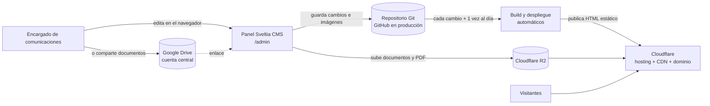

# Arquitectura — BIOING+

> **Estado actual** del sistema (no es una propuesta). Se mantiene en sitio: no lleva fecha.
> El dominio y el alcance están en `context.md`; el sistema visual, en `design.md`; lo que falta para
> producción, en `pendientes-infra.md`.

## 1. Vista general

Sitio **estático** (Astro) generado en el build a partir de **contenido en archivos** dentro del repositorio,
editado con **Sveltia CMS** en `/admin`. No hay backend, base de datos ni sesiones de usuario: el sitio
público son archivos HTML. La decisión y sus alternativas están en `adr/0001-sveltia-cms-astro.md`.



Consecuencias de diseño (ADR 0001): lo que depende de la fecha (Agenda próximas/realizadas, Anuncios
vencidos, Banners vigentes) se resuelve **en el build**, así que el sitio se reconstruye a diario.

## 2. Repositorio

```
README.md            → puerta de entrada (qué es, estado, puesta en marcha)
AGENTS.md            → reglas operativas para agentes de IA
docs/                → contexto, arquitectura, diseño, propuestas, planes, ADR, análisis
app/web              → el sitio (Astro + Sveltia CMS); acá vive todo el código
app/api              → sin uso por ahora (se descartó el backend propio)
.opencode/skills     → skills de IA del stack (herramienta local, gitignored: se regeneran con
                       `npx autoskills -y` desde `app/web`; no forman parte del entregable)
```

`app/web` (Astro 7, Node ≥ 22.12):

```
public/admin/        → panel Sveltia (index.html + config.yml, el modelo del CMS)
public/_headers      → encabezados de seguridad (CSP del sitio y otra para /admin)
public/_redirects    → redirecciones del sitio antiguo (vacío: espera las URLs de la carrera)
public/.well-known/security.txt → aviso de reporte de vulnerabilidades (RFC 9116; provisional, ver guia-mantencion §10)
src/content/         → el contenido (noticias, actividades, anuncios, documentos, personas, …)
src/content.config.ts→ espejo en Zod de config.yml
src/lib/             → reglas y helpers puros (+ *.test.ts)
src/layouts|components|pages|styles|scripts
scripts/             → datos sintéticos, postbuild de Pagefind, verificación de JSON-LD
auditoria/           → evidencia de la auditoría Lighthouse (Fase A)
wrangler.jsonc       → despliegue como Cloudflare Workers (Static Assets)
```

## 3. Stack y dependencias relevantes

| Pieza | Elección | Notas |
|---|---|---|
| Framework | **Astro 7** (salida estática) | `site` se fija con `SITE_URL` (`.env`); sin él, `https://bioing.example` |
| CMS | **Sveltia CMS** (pre-1.0) | Config compatible con Decap; el contenido no depende del editor |
| UI | **Starwind UI v3** + **Tailwind v4** | Componentes copiados al repo (`src/components/starwind/`), tema en `src/styles/starwind.css` |
| Íconos | **Phosphor** (`phosphor-astro`) | SVG sin tamaño propio: dimensionar con `size-*` |
| Animación | **GSAP** + View Transitions | `src/scripts/animaciones.ts`, `src/styles/transitions.css` |
| Buscador | **Pagefind** | Índice estático generado en `postbuild`; modal (component UI) cargado de forma diferida y `/buscar` con la UI clásica |
| Feeds | **@astrojs/rss** | `/noticias/rss.xml`, `/agenda/rss.xml` |
| Sitemap | **@astrojs/sitemap** | `sitemap-index.xml` (excluye `/admin/` y `/componentes/`) |
| Pruebas | **Vitest** (+ `lighthouse` y `wrangler` como devDependencies) | Reglas puras en `src/lib/*.test.ts` |

## 4. Modelo de contenido

Cada colección existe en dos espejos que **deben coincidir**: `app/web/public/admin/config.yml` (lo que ve
el editor) y `app/web/src/content.config.ts` (validación Zod en el build). Los términos del modelo son los de
`context.md`. Convenciones: cada campo `required: false` es `.optional()` (por `omit_empty_optional_fields`);
cada `relation` es `reference()`; los objetos "Persona u Organización" (Organizadores, Oferente) son
`z.discriminatedUnion('tipo', …)` con `typeKey: tipo` en `config.yml`. Borrador/Publicado es el booleano
`publicado` (no se usa el Editorial Workflow, porque impide crear entradas relacionadas desde el editor).

| Colección | Campos clave |
|---|---|
| **Personas** | nombre, descripción, foto, ficha activa, Perfil de egresado (autorizado, generación, año de egreso, Áreas, Organización, cargo, enlaces) |
| **Organizaciones** | nombre, tipo (empresa, institución, laboratorio, agrupación), sitio web, logo, ficha activa |
| **Noticias** | título, fecha, imagen, bajada, Temas, Áreas, Personas y Organizaciones mencionadas, Actividad (cobertura), Publicación de Instagram, etiquetas libres, Enlaces (hasta 6), Contenido incrustado (hasta 10) |
| **Actividades** | título, tipo (seminario, charla, congreso, taller, …), inicio, fin, modalidad, lugar, Organizadores, Expositores, Áreas, enlace de inscripción (botón principal), Enlaces (hasta 6), imagen, Contenido incrustado (hasta 10) |
| **Anuncios** | título, tipo de oportunidad, Oferente, Áreas, fecha, fecha límite, Contacto, enlace |
| **Documentos** | título, tipo, año, enlace (Drive), descripción, Temas, Áreas, palabras clave |
| **Banners** | título, texto, imagen, enlace, inicio, fin |
| **Páginas libres** | título, publicado, bajada (obligatoria), imagen y texto alternativo, `mostrar_en` (ninguno, footer, la-carrera, comunidad), destacar en el Inicio y resumen para el Inicio (una sola destacada, ADR 0006), video (YouTube), Enlaces (hasta 6), título y lista de bloques destacados, y cuerpo; una por archivo en `src/content/paginas-libres/` (ADR 0005). ¿Qué es la Bioingeniería? es una de ellas |
| **Inicio** | archivo único `src/content/inicio/inicio.md`: banda «Comunidad y documentos» (título y tarjetas del Directorio y del Repositorio: título, texto, botón, foto opcional) y lista de secciones destacadas (título, texto, botón, enlace, imagen, texto alternativo, publicado) |
| **Instagram** | título, enlace validado, fecha, imagen |
| **Áreas / Temas** | listas cerradas y editables por el Encargado |
| **SEO del sitio** | archivo único `src/content/seo/seo.yml` (colección `seo`): descripción general, imagen por defecto, descripción e imagen para redes de cada listado y códigos de verificación de Google y Bing. Todo opcional (ADR 0010) |
| **Encabezados de listados** | archivo único `src/content/encabezados/encabezados.yml` (colección `encabezados`): un objeto por listado con imagen de cabecera, texto alternativo e ícono. `EncabezadoListado.astro` lo dibuja en el `<h1>` de cada listado; `encabezadoDeListado()` lo lee. Todo opcional (ADR 0011) |

Las colecciones Noticias, Actividades, Anuncios, Documentos, Páginas libres y Personas traen además un campo `seo` opcional
(título ≤ 60, descripción ≤ 160, imagen y `noindex`), editado como bloque «SEO (opcional)». En `config.yml` ese bloque se define una vez con el ancla `&seo_contenido` (en Personas, la primera colección que lo usa: YAML exige que el ancla vaya antes del alias) y las demás colecciones lo referencian con `*seo_contenido`: no lo copies a mano.

**Menú y pie con Páginas libres**: `MENU` y `MENU_PRINCIPAL` (`src/lib/navegacion.ts`) son la lista fija de
enlaces. Las páginas publicadas (`paginasParaMenu()` en `src/lib/contenido.ts`) se agregan con `menuConPaginas`
(desplegables «La carrera» y «Comunidad», y su menú móvil) y `enlacesFooter` (pie de `Base.astro`), según
`mostrar_en`. Las funciones son puras y están probadas en `navegacion.test.ts`.

**Secciones ocultables**: el archivo único `src/content/menu/menu.yml` (colección `menu` en `content.config.ts`, editado como singleton «Secciones del sitio» en `config.yml`, ADR 0013) tiene un booleano por sección fija. `configuracionMenu()` (`src/lib/contenido.ts`) lo lee; `seccionVisible` y `filtrarMenu` (`navegacion.ts`) lo aplican en `Navbar.astro`, en el pie de `Base.astro` (también en el bloque «Comunidad») y en `seccionesLlms` (`llms.ts`). Si el archivo o una clave falta, la sección se muestra. Ocultar no toca las páginas: `[seccion].astro` sigue generando solo las rutas «Próximamente».

**Secciones desactivadas del todo** (ADR 0008): `seccionActiva` y `enlaceDisponible` (`navegacion.ts`) deciden qué se publica. `astro.config.mjs` lee `menu.yml` con `leerConfigMenu` y registra la integración `src/integrations/secciones-desactivadas.ts`, que en `astro:build:done` borra de `dist/` las rutas inactivas, filtra el sitemap y cambia por texto los enlaces a ellas en el HTML (con aviso). El Inicio (`index.astro`) y la ficha de persona filtran sus bloques y migajas con las mismas funciones.

**Íconos del panel** (ADR 0011): la lista curada está en `src/lib/iconos.ts`, el ancla `&iconos_phosphor` de `config.yml` y el mapa de componentes en `src/components/Icono.astro` (imports estáticos de `phosphor-astro`). `iconos.test.ts` comprueba que las tres coincidan. Un nombre desconocido no muestra ícono.

**Redes sociales en el pie**: el archivo único `src/content/redes/redes.yml` (colección `redes` en `content.config.ts`, editado como singleton «Redes sociales» en `config.yml`, ADR 0013) tiene una URL opcional por red (ADR 0009). `configuracionRedes()` (`src/lib/contenido.ts`) lo lee; `redesVisibles` y `urlsRedes` (`src/lib/redes.ts`, puro y probado en `redes.test.ts`) filtran las vacías y dan el orden. `RedesSociales.astro` dibuja los íconos en la columna de marca del pie, `Base.astro` pasa las URLs a `sitioWeb` (`sameAs`) y `instagram.astro` toma la URL de Instagram de aquí.

**Referencias entre colecciones**: guardan el slug (`entry.id`) de la entrada referenciada. Una referencia
rota (p. ej. una Persona borrada que sigue mencionada) se registra como `[ERROR] [content] Invalid content
reference` en el build **pero no lo hace fallar**: las páginas envuelven `getEntries()` con `existentes()`
(`src/lib/reglas.ts`) y descartan la entrada faltante. Revisar la salida del build para limpiarlas.

## 5. Rutas del sitio

| Ruta | Página |
|---|---|
| `/` | Inicio (hero en carrusel de Banners, página destacada de Páginas libres si hay una marcada, noticias, actividades, anuncios, Instagram, banda «Comunidad y documentos» con cifras del Directorio y últimos documentos, secciones destacadas con parallax) |
| `/p/[id]` | Páginas libres publicadas; `/p/bioingenieria` es ¿Qué es la Bioingeniería? (video en modal y bloques destacados). `/bioingenieria` ya no existe y no redirige |
| `/noticias` · `/noticias/[id]` | Listado con filtros y paginación de a 12 + ficha |
| `/agenda` · `/agenda/[id]` | Próximas y realizadas (pestañas) + ficha |
| `/anuncios` · `/anuncios/[id]` | Vigentes y archivo + ficha |
| `/directorio` · `/personas/[id]` | Buscador de egresados/as (filtros, chips de áreas y vista por generación, reflejados en la URL) + Ficha |
| `/repositorio` · `/repositorio/[id]` | Buscador de Documentos + ficha con vista previa |
| `/instagram` | Publicaciones seleccionadas |
| `/p/[id]` | Página libre (solo las publicadas; aparece en el menú o el pie según `mostrar_en`) |
| `/buscar` | Buscador general (Pagefind; solo funciona en build/preview). Con «Volver» (ver `design.md`, «Buscador») |
  Pagefind necesita `'wasm-unsafe-eval'` en `script-src` de la CSP pública (`public/_headers`) para compilar su WASM;
  sin eso el campo aparece pero no devuelve resultados. No habilita `eval` de JavaScript.
| `/anuario` | Anuario imprimible de egresados/as (imprimir → PDF) |
| `/noticias/rss.xml` · `/agenda/rss.xml` · `/robots.txt` · `/llms.txt` · `/sitemap-index.xml` | Artefactos generados |
| `/404` · `/componentes` | 404 del sitio · catálogo interno (solo en `npm run dev`) |

## 6. Capas del sitio

- **Páginas** consultan el contenido mediante `src/lib/contenido.ts` (`publicados()` filtra Borradores,
  `noticiasVisibles()`/`anunciosVisibles()` aplican fecha, `vinculosDe()` da el índice inverso de las
  Fichas). No usar `getCollection` directo en colecciones con campo `publicado`.
- **Reglas puras** en `src/lib/` (reglas de fecha, filtros, anuario, feeds, robots, llms, schema) con su
  `*.test.ts`. Las páginas no contienen lógica de negocio.
- **Listados con filtros** renderizan todas las tarjetas con atributos `data-*` y un `<script>` filtra en el
  cliente con la función pura correspondiente; `/noticias`, `/agenda`, `/anuncios`, `/repositorio` y `/directorio` reflejan los filtros en la URL con `sincronizarFiltrosEnUrl` (`src/scripts/url-filtros.ts`), y `/noticias` además pagina. En `/directorio` el orden «Por generación» también va en la URL (`?orden=generacion`) y reagrupa las mismas tarjetas, sin duplicarlas.
- **Componentes** reutilizables en `src/components/` (tarjetas, `EnlaceFicha`, `HeroCarrusel`, …). Las
  tarjetas son 100 % clicables y reservan aspecto (`aspect-video`, `aspect-square`) para no tener CLS.
- **Fechas**: los campos con hora llevan offset de America/Santiago y se muestran con `formatoFechaHora`;
  las fechas solas (`AAAA-MM-DD`) se parsean como medianoche UTC y se muestran con `formatoFecha` (en UTC),
  para no correr el día.

## 7. Imágenes y medios

- Las imágenes del sitio viven en `app/web/src/assets/media/` y se referencian con el alias del tsconfig
  (`'@/assets/media/…'`, entre comillas en YAML) para que `image()` las optimice. Es el `public_folder` global
  de `config.yml`; las colecciones no lo redefinen (Sveltia ignoraba la ruta relativa por colección y
  escribía `/media/…`, que rompía el build); se publican con `<Image>` (o `getImage`) con
  `widths`/`sizes`. El **hero** (slide 0) va con `priority` y un `<link rel="preload">` del LCP; el resto
  carga `lazy`. Mantener estos atributos al agregar imágenes.
- Al **subir** desde el panel, `config.yml` reduce a 2048 px, convierte a WebP calidad 85 y acepta HEIC.
- Los **Documentos** van a Google Drive (cuenta central, enlace) o a Cloudflare R2; el sitio muestra la vista
  previa correspondiente. Los embeds de terceros forman una lista cerrada (la tabla de
  `docs/guia-evolucion.md` §3.6) y se cargan de forma diferida: YouTube sin cookies, Spotify, Vimeo, Twitch,
  TikTok, Instagram, Google Maps, entre otros. El **contenido incrustado** de Noticias y Actividades (campo `incrustados`) se convierte en
  `src/lib/incrustados.ts`, un parser puro con prueba: a partir de la URL pegada decide el reproductor (o la
  tarjeta-enlace para lo que no se incrusta) y es el único punto para sumar un proveedor. El componente
  `src/components/Incrustados.astro` lo renderiza.
- Los **Enlaces** (campo `enlaces`, hasta 6 `{ etiqueta, url }`) son botones de texto corto bajo el título de
  Noticias, Actividades y Páginas libres (`src/components/Enlaces.astro`). No reproducen nada: eso es el contenido
  incrustado. En una Actividad, `enlace_inscripcion` es el botón principal y los `enlaces` van a su lado. La regla
  interno/externo es `esInterno()` en `src/lib/enlaces.ts` (ruta relativa o mismo host, con prueba): los externos
  abren en pestaña nueva y los internos no.
- El **logo** tiene una sola fuente: `src/assets/logo.svg`, renderizado por `src/components/Logo.astro` en
  navbar y footer (hoy es un placeholder hasta la identidad definitiva).
- **Navbar**: el header vive en `src/components/Navbar.astro` (escritorio y menú móvil), con la estructura de
  `MENU_PRINCIPAL` en `src/lib/navegacion.ts` y el comportamiento (desplegables, atajo `Ctrl+K`, ocultar al bajar)
  en `src/scripts/navbar.ts`. `MENU` sigue siendo la única lista de páginas para el footer, `llms.txt` y `schema.ts`.
- **Buscador en modal**: `<pagefind-modal>` en `Base.astro` (solo en el build) y `src/scripts/buscador.ts`, que
  agrega `/pagefind/pagefind-component-ui.js` y su CSS después de la carga. Son archivos del propio sitio, así que
  caben en la CSP sin `'unsafe-inline'`. Decisión en `docs/adr/0007-buscador-en-modal.md`.

## 8. SEO, datos estructurados y descubrimiento

- **JSON-LD (Schema.org)**: constructores puros en `src/lib/schema.ts`; `Base.astro` acepta la prop `jsonLd`
  y **siempre** emite `WebSite` + `Organization`. Por página: `NewsArticle`, `Event`, `JobPosting` (solo
  trabajo/práctica/pasantía vigente), `Person` (solo datos ya publicados), `DigitalDocument`,
  `BreadcrumbList` e `ItemList` en el Directorio. Se verifica con `npm run verificar:jsonld` sobre `dist/`.
  No hay `SearchAction`: Pagefind UI no lee `?q=`.
- **`robots.txt` y `llms.txt`** son rutas generadas en el build (`src/pages/robots.txt.ts` y
  `src/pages/llms.txt.ts`, lógica en `src/lib/robots.ts` y `llms.ts`). No crear archivos con esos nombres en
  `public/`: en Astro el estático gana al generado. La política de bots de IA se edita solo en `robots.ts`.
- **Feeds RSS**: `src/lib/feeds.ts` + `src/pages/{noticias,agenda}/rss.xml.ts`, anunciados con
  `<link rel="alternate">` en sus listados.
- **Metadatos**: canonical, Open Graph y Twitter en `Base.astro` (`og-default.png` como imagen por defecto). Los
  valores salen de `src/lib/seo.ts` (puro, probado en `seo.test.ts`), con la precedencia de ADR 0010: campo SEO de la
  entrada → valor armado por la página → `seo.yml` → valor por defecto del código. `Base.astro` agrega el sufijo
  « · BIOING+» una sola vez, emite `<meta name="robots" content="noindex">` si la página lo pide y las metas de
  verificación de Google (`google-site-verification`) y Bing (`msvalidate.01`) solo con códigos cargados.
- **Analítica sin cookies** (ADR 0012): `Base.astro` carga el beacon de Cloudflare Web Analytics solo si
  `analiticaCloudflare()` (`src/lib/seo.ts`) recibe un token válido de `seo.yml`; `spa: true` mide las navegaciones del
  ClientRouter. La CSP de `public/_headers` admite `static.cloudflareinsights.com` (script) y `cloudflareinsights.com` (connect).
- **No mostrar en buscadores** (`noindex`): la página sigue publicada y enlazada. La integración
  `src/integrations/secciones-desactivadas.ts` la saca del sitemap detectando la meta en el HTML generado, y
  `scripts/postbuild-pagefind.mjs` no la indexa. `llms.txt` lista solo secciones, así que no la incluye de todos modos.
- **Analítica**: prevista sin cookies (Cloudflare Web Analytics); todavía no implementada.

## 9. Rendimiento y accesibilidad

Metas de la entrega: Lighthouse ≥ 90 en las cuatro categorías y WCAG 2.1 AA. Evidencia y método en
`app/web/auditoria/` (`npm run build && npm run postbuild`, servir `dist/` y correr Lighthouse headless).
Animaciones GSAP + View Transitions: todo respeta `prefers-reduced-motion` y el contenido es visible sin
JavaScript (clase `.anima` + guard). El hero usa foto con tinte cálido + velo oscuro; se descartaron los
shaders WebGL y la textura halftone por rendimiento y por decisión del equipo.

## 10. Build, despliegue y operación

- Comandos (ver `README.md` para el detalle): `npm run dev`, `npm test`, `npx astro check`,
  `npm run build`, `npm run postbuild`, `npm run preview`, `npm run datos:generar`/`datos:limpiar`,
  `npm run verificar:jsonld`, `npm run dev:tunel`.
- **Pagefind y verificar:jsonld** solo existen sobre `dist/`: con npm 11, `postbuild` no se dispara solo.
- **Ambientes en Cloudflare** ([ADR 0003](adr/0003-cuenta-central-anticipada-y-ambientes.md)): dos Workers de
  assets estáticos definidos en `wrangler.jsonc` — `bioing-web` (producción, rama `main`; nivel superior) y
  `bioing-web-qa` (QA, publicada a mano; `env.qa`). Ambos en `*.workers.dev` hasta que exista el dominio
  oficial, que se agrega a producción con `routes` + `custom_domain`. `npm run deploy:dev` publica **solo QA**
  (`wrangler deploy --env qa`); producción se publica por Workers Builds, que construye **solo `main`**
  ([ADR 0004](adr/0004-flujo-de-trabajo-una-persona.md)). Paso a paso, CI/CD, reconstrucción
  diaria (Deploy Hook) y redespliegue con dominio:
  [`plans/2026-10-11-plan-ambientes-qa-produccion.md`](plans/2026-10-11-plan-ambientes-qa-produccion.md);
  procedimiento manual y verificación: [`despliegue-cloudflare.md`](despliegue-cloudflare.md).
  Antes de construir, fijar `SITE_URL` con la URL del ambiente para que canonical, sitemap,
  `robots.txt`/`llms.txt`, feeds y JSON-LD apunten ahí. `wrangler.jsonc` sirve el 404 propio
  (`assets.not_found_handling: "404-page"`) y `_headers` marca `*.workers.dev` como `noindex` (el patrón no
  alcanza al dominio definitivo). El panel (`/admin/`) inicia sesión recién cuando el backend sea `github`
  con el Worker de autenticación (etapa 4 del plan); el contenido se edita **solo desde producción**, porque
  el `config.yml` de ambos ambientes escribe en `main`.
- **Publicación**: cada push al repositorio (también los commits que hace Sveltia al publicar) dispara build +
  deploy en Cloudflare, mediante la app de GitHub de Workers Builds. Lo que depende de la fecha se actualiza con
  una reconstrucción diaria: `.github/workflows/reconstruccion-diaria.yml` (GitHub Actions, `15 4 * * *` UTC =
  00:15/01:15 de Chile) hace `POST` al Deploy Hook de `bioing-web`, guardado en el secret `CF_DEPLOY_HOOK_URL`.
- **Contenido de prueba**: `npm run datos:generar` crea contenido `sint-*` (ignorado por git) y
  `datos:limpiar` lo borra. Con el servidor de dev corriendo, reiniciarlo después de generar (no detecta
  cientos de archivos nuevos de una vez).
- Los detalles operativos y los pendientes de infraestructura están en `pendientes-infra.md`.

## 11. Deuda y riesgos conocidos

- **Sveltia es pre-1.0**: mitiga el que el contenido no dependa de él (Markdown/YAML estándar).
- **Sin comprobación de tipos en el CMS**: el esquema Zod del build es la red de seguridad; `astro check`
  debe quedar en 0.
- **Una referencia rota no rompe el build** (se descarta): hay que revisar la salida del build.
- **Buscadores en el navegador**: adecuados para cientos o miles de registros, no para volúmenes mucho
  mayores.
- **Dependencias de terceros** (Instagram, Google Drive): pueden cambiar o romper enlaces; hay revisión
  pendiente de enlaces.
- **Capacidad del repositorio**: aviso al superar 1 GB (imágenes) y caché de imágenes optimizadas entre
  builds si el tiempo de construcción crece.
