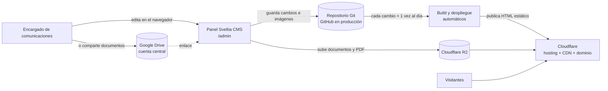

# Arquitectura — BIOING+

> **Estado actual** del sistema (no es una propuesta). Se mantiene en sitio: no lleva fecha.
> El dominio y el alcance están en `context.md`; el sistema visual, en `design.md`; lo que falta para
> producción, en `pendientes-infra.md`.

## 1. Vista general

Sitio **estático** (Astro) generado en el build a partir de **contenido en archivos** dentro del repositorio,
editado con **Sveltia CMS** en `/admin`. No hay backend, base de datos ni sesiones de usuario: el sitio
público son archivos HTML. La decisión y sus alternativas están en `adr/0001-sveltia-cms-astro.md`.



Consecuencias de diseño (ADR 0001): lo que depende de la fecha (Agenda próximas/realizadas, Anuncios
vencidos, Banners vigentes) se resuelve **en el build**, así que el sitio se reconstruye a diario.

## 2. Repositorio

```
README.md            → puerta de entrada (qué es, estado, puesta en marcha)
AGENTS.md            → reglas operativas para agentes de IA
docs/                → contexto, arquitectura, diseño, propuestas, planes, ADR, análisis
app/web              → el sitio (Astro + Sveltia CMS); acá vive todo el código
app/api              → sin uso por ahora (se descartó el backend propio)
```

`app/web` (Astro 7, Node ≥ 22.12):

```
public/admin/        → panel Sveltia (index.html + config.yml, el modelo del CMS)
public/_headers      → encabezados de seguridad (CSP del sitio y otra para /admin)
public/_redirects    → redirecciones del sitio antiguo (vacío: espera las URLs de la carrera)
src/content/         → el contenido (noticias, actividades, anuncios, documentos, personas, …)
src/content.config.ts→ espejo en Zod de config.yml
src/lib/             → reglas y helpers puros (+ *.test.ts)
src/layouts|components|pages|styles|scripts
scripts/             → datos sintéticos, postbuild de Pagefind, verificación de JSON-LD
auditoria/           → evidencia de la auditoría Lighthouse (Fase A)
wrangler.jsonc       → despliegue como Cloudflare Workers (Static Assets)
```

## 3. Stack y dependencias relevantes

| Pieza | Elección | Notas |
|---|---|---|
| Framework | **Astro 7** (salida estática) | `site` se fija con `SITE_URL` (`.env`); sin él, `https://bioing.example` |
| CMS | **Sveltia CMS** (pre-1.0) | Config compatible con Decap; el contenido no depende del editor |
| UI | **Starwind UI v3** + **Tailwind v4** | Componentes copiados al repo (`src/components/starwind/`), tema en `src/styles/starwind.css` |
| Íconos | **Phosphor** (`phosphor-astro`) | SVG sin tamaño propio: dimensionar con `size-*` |
| Animación | **GSAP** + View Transitions | `src/scripts/animaciones.ts`, `src/styles/transitions.css` |
| Buscador | **Pagefind** | Índice estático generado en `postbuild` |
| Feeds | **@astrojs/rss** | `/noticias/rss.xml`, `/agenda/rss.xml` |
| Sitemap | **@astrojs/sitemap** | `sitemap-index.xml` (excluye `/admin/` y `/componentes/`) |
| Pruebas | **Vitest** (+ `lighthouse` y `wrangler` como devDependencies) | Reglas puras en `src/lib/*.test.ts` |

## 4. Modelo de contenido

Cada colección existe en dos espejos que **deben coincidir**: `app/web/public/admin/config.yml` (lo que ve
el editor) y `app/web/src/content.config.ts` (validación Zod en el build). Los términos del modelo son los de
`context.md`. Convenciones: cada campo `required: false` es `.optional()` (por `omit_empty_optional_fields`);
cada `relation` es `reference()`; los objetos "Persona u Organización" (Organizadores, Oferente) son
`z.discriminatedUnion('tipo', …)` con `typeKey: tipo` en `config.yml`. Borrador/Publicado es el booleano
`publicado` (no se usa el Editorial Workflow, porque impide crear entradas relacionadas desde el editor).

| Colección | Campos clave |
|---|---|
| **Personas** | nombre, descripción, foto, ficha activa, Perfil de egresado (autorizado, generación, año de egreso, Áreas, Organización, cargo, enlaces) |
| **Organizaciones** | nombre, tipo (empresa, institución, laboratorio, agrupación), sitio web, logo, ficha activa |
| **Noticias** | título, fecha, imagen, bajada, Temas, Áreas, Personas y Organizaciones mencionadas, Actividad (cobertura), Publicación de Instagram, etiquetas libres |
| **Actividades** | título, tipo (seminario, charla, congreso, taller, …), inicio, fin, modalidad, lugar, Organizadores, Expositores, Áreas, enlace de inscripción, imagen |
| **Anuncios** | título, tipo de oportunidad, Oferente, Áreas, fecha, fecha límite, Contacto, enlace |
| **Documentos** | título, tipo, año, enlace (Drive), descripción, Temas, Áreas, palabras clave |
| **Banners** | título, texto, imagen, enlace, inicio, fin |
| **Páginas** | archivo único institucional (¿Qué es la Bioingeniería?): título, bajada, video, características |
| **Instagram** | título, enlace validado, fecha, imagen |
| **Áreas / Temas** | listas cerradas y editables por el Encargado |

**Referencias entre colecciones**: guardan el slug (`entry.id`) de la entrada referenciada. Una referencia
rota (p. ej. una Persona borrada que sigue mencionada) se registra como `[ERROR] [content] Invalid content
reference` en el build **pero no lo hace fallar**: las páginas envuelven `getEntries()` con `existentes()`
(`src/lib/reglas.ts`) y descartan la entrada faltante. Revisar la salida del build para limpiarlas.

## 5. Rutas del sitio

| Ruta | Página |
|---|---|
| `/` | Inicio (hero en carrusel de Banners, noticias, actividades, anuncios, Instagram) |
| `/bioingenieria` | ¿Qué es la Bioingeniería? (video en modal) |
| `/noticias` · `/noticias/[id]` | Listado con filtros y paginación de a 12 + ficha |
| `/agenda` · `/agenda/[id]` | Próximas y realizadas (pestañas) + ficha |
| `/anuncios` · `/anuncios/[id]` | Vigentes y archivo + ficha |
| `/directorio` · `/personas/[id]` | Buscador de egresados/as + Ficha |
| `/repositorio` · `/repositorio/[id]` | Buscador de Documentos + ficha con vista previa |
| `/instagram` | Publicaciones seleccionadas |
| `/buscar` | Buscador general (Pagefind; solo funciona en build/preview) |
| `/anuario` | Anuario imprimible de egresados/as (imprimir → PDF) |
| `/noticias/rss.xml` · `/agenda/rss.xml` · `/robots.txt` · `/llms.txt` · `/sitemap-index.xml` | Artefactos generados |
| `/404` · `/componentes` | 404 del sitio · catálogo interno (solo en `npm run dev`) |

## 6. Capas del sitio

- **Páginas** consultan el contenido mediante `src/lib/contenido.ts` (`publicados()` filtra Borradores,
  `noticiasVisibles()`/`anunciosVisibles()` aplican fecha, `vinculosDe()` da el índice inverso de las
  Fichas). No usar `getCollection` directo en colecciones con campo `publicado`.
- **Reglas puras** en `src/lib/` (reglas de fecha, filtros, anuario, feeds, robots, llms, schema) con su
  `*.test.ts`. Las páginas no contienen lógica de negocio.
- **Listados con filtros** renderizan todas las tarjetas con atributos `data-*` y un `<script>` filtra en el
  cliente con la función pura correspondiente; `/noticias` además refleja los filtros en la URL y pagina.
- **Componentes** reutilizables en `src/components/` (tarjetas, `EnlaceFicha`, `HeroCarrusel`, …). Las
  tarjetas son 100 % clicables y reservan aspecto (`aspect-video`, `aspect-square`) para no tener CLS.
- **Fechas**: los campos con hora llevan offset de America/Santiago y se muestran con `formatoFechaHora`;
  las fechas solas (`AAAA-MM-DD`) se parsean como medianoche UTC y se muestran con `formatoFecha` (en UTC),
  para no correr el día.

## 7. Imágenes y medios

- Las imágenes del sitio viven en `app/web/src/assets/media/` y se referencian con ruta relativa
  (`../../assets/media/…`) para que `image()` las optimice; se publican con `<Image>` (o `getImage`) con
  `widths`/`sizes`. El **hero** (slide 0) va con `priority` y un `<link rel="preload">` del LCP; el resto
  carga `lazy`. Mantener estos atributos al agregar imágenes.
- Al **subir** desde el panel, `config.yml` reduce a 2048 px, convierte a WebP calidad 85 y acepta HEIC.
- Los **Documentos** van a Google Drive (cuenta central, enlace) o a Cloudflare R2; el sitio muestra la vista
  previa correspondiente. Los embeds de terceros (YouTube sin cookies, Vimeo, Drive, Instagram) forman una
  lista cerrada y se cargan de forma diferida.
- El **logo** tiene una sola fuente: `src/assets/logo.svg`, renderizado por `src/components/Logo.astro` en
  navbar y footer (hoy es un placeholder hasta la identidad definitiva).

## 8. SEO, datos estructurados y descubrimiento

- **JSON-LD (Schema.org)**: constructores puros en `src/lib/schema.ts`; `Base.astro` acepta la prop `jsonLd`
  y **siempre** emite `WebSite` + `Organization`. Por página: `NewsArticle`, `Event`, `JobPosting` (solo
  trabajo/práctica/pasantía vigente), `Person` (solo datos ya publicados), `DigitalDocument`,
  `BreadcrumbList` e `ItemList` en el Directorio. Se verifica con `npm run verificar:jsonld` sobre `dist/`.
  No hay `SearchAction`: Pagefind UI no lee `?q=`.
- **`robots.txt` y `llms.txt`** son rutas generadas en el build (`src/pages/robots.txt.ts` y
  `src/pages/llms.txt.ts`, lógica en `src/lib/robots.ts` y `llms.ts`). No crear archivos con esos nombres en
  `public/`: en Astro el estático gana al generado. La política de bots de IA se edita solo en `robots.ts`.
- **Feeds RSS**: `src/lib/feeds.ts` + `src/pages/{noticias,agenda}/rss.xml.ts`, anunciados con
  `<link rel="alternate">` en sus listados.
- **Metadatos**: canonical y Open Graph/Twitter en `Base.astro` (`og-default.png` como imagen por defecto).
- **Analítica**: prevista sin cookies (Cloudflare Web Analytics); todavía no implementada.

## 9. Rendimiento y accesibilidad

Metas de la entrega: Lighthouse ≥ 90 en las cuatro categorías y WCAG 2.1 AA. Evidencia y método en
`app/web/auditoria/` (`npm run build && npm run postbuild`, servir `dist/` y correr Lighthouse headless).
Animaciones GSAP + View Transitions: todo respeta `prefers-reduced-motion` y el contenido es visible sin
JavaScript (clase `.anima` + guard). El hero usa foto con tinte cálido + velo oscuro; se descartaron los
shaders WebGL y la textura halftone por rendimiento y por decisión del equipo.

## 10. Build, despliegue y operación

- Comandos (ver `README.md` para el detalle): `npm run dev`, `npm test`, `npx astro check`,
  `npm run build`, `npm run postbuild`, `npm run preview`, `npm run datos:generar`/`datos:limpiar`,
  `npm run verificar:jsonld`, `npm run dev:tunel`.
- **Pagefind y verificar:jsonld** solo existen sobre `dist/`: con npm 11, `postbuild` no se dispara solo.
- **Publicación**: cada cambio en el repositorio dispara build + deploy en Cloudflare; una reconstrucción
  diaria poco después de medianoche de Chile actualiza lo que depende de la fecha.
- **Contenido de prueba**: `npm run datos:generar` crea contenido `sint-*` (ignorado por git) y
  `datos:limpiar` lo borra. Con el servidor de dev corriendo, reiniciarlo después de generar (no detecta
  cientos de archivos nuevos de una vez).
- Los detalles operativos y los pendientes de infraestructura están en `pendientes-infra.md`.

## 11. Deuda y riesgos conocidos

- **Sveltia es pre-1.0**: mitiga el que el contenido no dependa de él (Markdown/YAML estándar).
- **Sin comprobación de tipos en el CMS**: el esquema Zod del build es la red de seguridad; `astro check`
  debe quedar en 0.
- **Una referencia rota no rompe el build** (se descarta): hay que revisar la salida del build.
- **Buscadores en el navegador**: adecuados para cientos o miles de registros, no para volúmenes mucho
  mayores.
- **Dependencias de terceros** (Instagram, Google Drive): pueden cambiar o romper enlaces; hay revisión
  pendiente de enlaces.
- **Capacidad del repositorio**: aviso al superar 1 GB (imágenes) y caché de imágenes optimizadas entre
  builds si el tiempo de construcción crece.
