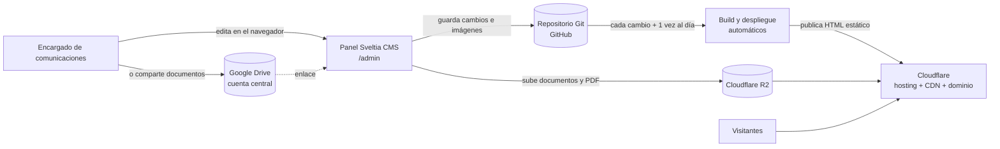

# Propuesta de desarrollo — Sitio web y gestor de contenidos BIOING+

**Cliente:** Carrera de Bioingeniería, Facultad de Ciencias Biológicas, Universidad de Concepción
**Contrapartes:** Jefatura de carrera, periodista (Encargado de comunicaciones) y responsable del proyecto
**Fecha:** 10 de octubre de 2026 · **Versión:** 2

---

## 1. Resumen

Se propone construir el sitio web de BIOING+ como un **sitio moderno, rápido y responsivo** (landing page con secciones de Noticias, Agenda, Anuncios, Directorio de egresados/as y Repositorio), acompañado de un **gestor de contenidos (CMS)** para que la persona encargada de comunicaciones publique sin conocimientos técnicos.

La arquitectura es **desacoplada**: el contenido y la presentación están separados. El contenido se guarda como archivos en un repositorio Git, lo que entrega historial completo de cambios, respaldo automático y la posibilidad de revertir cualquier edición. El sitio se publica en infraestructura **serverless de Cloudflare**, sin servidores que mantener ni parchar.

Esta solución **reemplaza WordPress** por un esquema con una superficie de ataque mucho menor y costos de operación cercanos a cero.

## 2. Objetivos

1. Contar con un sitio propio de BIOING+, vinculado a la FCB pero con identidad y estructura propias.
2. Permitir que el Encargado de comunicaciones publique y actualice contenido de forma autónoma.
3. Reducir los riesgos de seguridad y la carga de mantención asociados a WordPress.
4. Dejar una base mantenible y documentada, con control de versiones de todo el contenido.
5. Habilitar, a futuro, la integración con agentes de IA para asistir la gestión de contenidos.

## 3. Alcance

**Sitio web** (según `Propuesta de arquitectura y contenidos para sitio web BIOING.md`):

- Inicio con contenidos destacados y dinámicos (Banner, noticias recientes, próximas actividades, anuncios vigentes).
- ¿Qué es la Bioingeniería? (contenido institucional y video).
- Noticias con buscador y filtros (tema, persona mencionada, fecha).
- Agenda de actividades (próximas y realizadas).
- Anuncios de oportunidades (trabajo, prácticas, pasantías, convocatorias).
- Directorio de bioingenieros/as con filtros (generación, área, organización) y Fichas individuales.
- Repositorio de documentos con buscador.
- Publicaciones de Instagram seleccionadas: el Encargado de comunicaciones pega el enlace de una publicación y el sitio la muestra con el embed oficial de Instagram (ver 6.2).
- Anuario de egresados/as en PDF.
- Contenido multimedia en noticias y otras secciones: videos, galerías de fotos, documentos de Google Drive y PDF (ver 6.3).
- Buscador general del sitio (índice estático, sin servidor), SEO básico (sitemap y metadatos para redes sociales) y analítica respetuosa de la privacidad (Cloudflare Web Analytics, sin cookies).
- Diseño responsivo y accesible.

**Metas de calidad** (se verifican en la entrega):

- Accesibilidad según WCAG 2.1 nivel AA.
- Puntaje Lighthouse ≥ 90 en rendimiento, accesibilidad, buenas prácticas y SEO, en las páginas principales.
- Funcionamiento en las dos últimas versiones de Chrome, Firefox, Safari y Edge, en escritorio y móvil.

**Gestor de contenidos:** panel de administración web para crear, editar y publicar cada tipo de contenido, con borradores, vínculos entre contenidos (por ejemplo, las personas mencionadas en una noticia) y carga de imágenes.

**Fuera de alcance** (salvo acuerdo posterior): inscripciones o formularios propios (se enlazan servicios externos), cuentas de usuario para la comunidad, contenido multilenguaje, migración masiva de contenidos desde el sitio actual.

## 4. Por qué reemplazar WordPress

| Aspecto | WordPress | Propuesta (CMS basado en Git + sitio estático) |
|---|---|---|
| Superficie de ataque | Servidor PHP, base de datos y plugins expuestos a internet; son la principal fuente de vulnerabilidades | El sitio público son archivos estáticos: no hay base de datos ni código de servidor que atacar |
| Mantención | Actualizaciones frecuentes de núcleo, tema y plugins; riesgo de incompatibilidades | Sin servidor que parchar; las dependencias se actualizan en el código, con pruebas |
| Respaldo e historial | Requiere plugins o respaldos manuales de la base de datos | Cada cambio es un registro en Git: historial completo y reversión de cualquier edición |
| Costo de hosting | Servidor o hosting administrado con costo mensual | Plan gratuito de Cloudflare suficiente para el volumen esperado |
| Rendimiento | Páginas generadas en cada visita | HTML ya generado, servido desde la red global de Cloudflare |
| Integración con IA | Limitada, vía plugins | El contenido son archivos de texto estructurado: un agente de IA puede leerlos y proponer cambios revisables |

## 5. Alternativas evaluadas

| Criterio | WordPress | WordPress headless + Next.js | Payload CMS + Next.js | **Sveltia CMS + Astro** |
|---|---|---|---|---|
| Seguridad | Baja: servidor, BD y plugins expuestos | Media: el sitio es independiente, pero WordPress sigue existiendo y hay que protegerlo | Media-alta: CMS moderno, pero requiere servidor y base de datos | **Alta**: sin servidor ni base de datos propios |
| Infraestructura | Servidor PHP + MySQL | Servidor WordPress + hosting Next.js | Servidor Node + base de datos + hosting | **Solo hosting estático + repositorio Git** |
| Costo mensual | Hosting pagado | Dos servicios | Servidor y base de datos | **Cercano a cero** |
| Mantención | Alta | Alta (dos sistemas) | Media | **Baja** |
| Control de versiones del contenido | No nativo | No nativo | No nativo (base de datos) | **Nativo (Git)** |
| Facilidad para quien edita | Alta (conocido) | Alta (conocido) | Alta | Alta: panel web moderno, edición con vista previa |
| Integración con agentes de IA | Limitada | Vía API | Vía API | **Directa sobre los archivos, con revisión** |
| Rendimiento y SEO | Medio | Alto | Alto | **Alto: HTML estático** |

**Recomendación: Sveltia CMS + Astro.** Sveltia CMS usa Git de forma nativa (el contenido vive en el repositorio y cada publicación es un cambio registrado), y Astro genera el sitio como HTML estático, lo que da el mejor rendimiento y la menor superficie de ataque. Ambos son de código abierto y el contenido queda en formatos estándar (Markdown/YAML), sin dependencia de un proveedor: si en el futuro se cambia de CMS, el contenido se conserva tal cual.

**Riesgos considerados:** Sveltia CMS es un proyecto activo pero anterior a su versión 1.0; se mitiga porque su configuración es compatible con Decap CMS y el contenido no depende de él. Un sitio estático requiere reconstruirse para reflejar cambios que dependen de la fecha (agenda, anuncios vencidos); se resuelve con una reconstrucción automática diaria.

## 6. Arquitectura propuesta

| Componente | Tecnología | Función |
|---|---|---|
| Sitio público | Astro (HTML estático) | Genera todas las páginas, buscadores y filtros |
| Gestor de contenidos | Sveltia CMS | Panel web de edición en `/admin` |
| Código y contenido | Repositorio Git privado en **GitHub** (alternativa: GitLab; ver 6.6) | Fuente única de verdad, con historial completo |
| Imágenes | Repositorio Git, optimizadas al subir y al construir (ver 6.4) | Se publican en varios tamaños y formatos modernos |
| Documentos y PDF | Google Drive de la cuenta central (enlace) **o** Cloudflare R2 (subida desde el panel, servido en `/media`) | Ambas opciones disponibles en el mismo campo; ver 6.3 |
| Hosting y dominio | Cloudflare (DNS, CDN, hosting estático) | Publicación global, HTTPS y protección ante ataques |
| Acceso al panel | Cuenta de GitHub del editor, con doble factor | Solo quien tiene permiso de escritura en el repositorio puede publicar |

**Datos personales:** el repositorio es privado y solo contiene datos que las personas autorizaron publicar. Los datos de contacto internos y las solicitudes de la comunidad permanecen en el formulario de Google, fuera del sitio.

### 6.1 Dominio

Se requiere **un solo dominio**. Todos los servicios quedan bajo él:

| Servicio | Dirección |
|---|---|
| Sitio público | `https://dominio/` |
| Panel de administración | `https://dominio/admin/` |
| Imágenes y documentos (R2) | `https://dominio/media/…` |
| Inicio de sesión del panel | Una ruta `/auth` en el mismo dominio (pequeño Worker de autenticación de Sveltia, gratuito); con GitLab no se necesita |

Por el principio de **autonomía** (sección 6.5), se recomienda un **dominio propio** y no un subdominio de la universidad:

| Opción | Qué implica |
|---|---|
| **Dominio `.org` o `.com` en Cloudflare Registrar** (recomendado) | Dominio, DNS, hosting, almacenamiento y facturación en una sola cuenta, con renovación automática. |
| **Dominio `.cl` en NIC Chile** | Identidad local, pero NIC Chile exige un titular con RUT (una persona o una institución) y se administra fuera de Cloudflare. Hay que definir el titular desde el inicio. |
| Subdominio UdeC (p. ej. `bioing.udec.cl`) | Descartado por dependencia: el DNS lo controla TI de la universidad. Queda como alternativa si la institución lo exige. |

Si el nombre del dominio incluye la marca "UdeC", conviene confirmar que la universidad lo autoriza.

### 6.2 Instagram

En lugar de un feed automático, se propone mostrar **publicaciones seleccionadas**:

- En el panel, el Encargado de comunicaciones **pega el enlace** de una publicación o reel (`instagram.com/p/…` o `/reel/…`); el campo valida que sea un enlace de Instagram.
- El sitio las muestra en la sección Instagram y en el Inicio, y una Noticia puede incluir su publicación relacionada.
- Se usa el **embed oficial** de Instagram (el mismo código del botón "Insertar"), que no requiere cuenta de desarrollador, token ni aprobación de Meta.
- Para cuidar la **privacidad y el rendimiento**, cada publicación se muestra primero como una tarjeta liviana del propio sitio; el contenido de Instagram (que carga cookies y seguimiento de Meta) se carga solo cuando la persona lo pide o llega a esa parte de la página.

**Diferencia con la propuesta original:** el feed no se actualiza solo; la carrera elige qué mostrar. A cambio, se elimina la dependencia de la API de Meta (token que vence, cuenta profesional obligatoria y cambios de condiciones). Si más adelante se requiere un feed automático, se cotiza aparte.

### 6.3 Contenido multimedia e incrustado

Las Noticias (y otras secciones que se definan) incluyen **bloques de contenido** que el Encargado de comunicaciones agrega en el orden que quiera. **Solo se pega un enlace o se sube un archivo; el sitio genera el código de inserción.** No se permite pegar código `<iframe>` ni HTML, y los proveedores aceptados forman una lista cerrada, lo que evita insertar contenido malicioso.

| Bloque | Cómo se muestra | Consideraciones |
|---|---|---|
| **Video** (YouTube, Vimeo) | Reproductor incrustado | Se muestra la miniatura y el reproductor se carga al hacer clic; YouTube en modo sin cookies (`youtube-nocookie.com`) |
| **Galería de fotos** | Grilla con ampliación al hacer clic | Imágenes optimizadas (ver 6.4), con pie de foto |
| **Documento de Google Drive** (Docs, Sheets, Slides, PDF, video) | Vista previa oficial de Google | Solo funciona si el archivo está compartido como "cualquier persona con el enlace" |
| **PDF** (subido al sitio) | Visor dentro de la página con botón "Abrir / Descargar" | En móviles la vista previa no es fiable (iPhone suele mostrar la primera página; Android lo descarga); el botón garantiza el acceso |
| **Enlace a página web** | Tarjeta con título, imagen y descripción de la página | No se usa iframe porque muchos sitios lo bloquean; los datos se obtienen al construir el sitio |

**Documentos: dos opciones en el mismo campo.** El campo "documento" acepta un **enlace de Google Drive** o un **archivo subido a R2** desde el panel, y el sitio muestra la vista previa que corresponda. Se puede partir solo con Drive y activar R2 cuando se necesite, sin cambiar el sitio.

| Conviene | Cuándo |
|---|---|
| **Google Drive** | Documentos vivos que se editan (Docs, Sheets, Slides), o cuando se prefiere la familiaridad de Drive |
| **Cloudflare R2** | PDF finales (reglamentos, informes, decretos): el archivo queda bajo el dominio del sitio, sin cookies de terceros, con enlaces estables y subida desde el mismo panel |

Reglas para documentos en Drive:

- Los archivos pertenecen siempre a la **cuenta central** (se suben desde ella o se le transfiere la propiedad); un archivo de una cuenta personal desaparece si esa persona se va.
- Se comparten como "cualquier persona con el enlace" **solo** dentro de una carpeta pública dedicada; nunca se comparte una carpeta con información interna.
- La reconstrucción diaria revisa los enlaces y avisa si alguno dejó de funcionar.

Todos los contenidos incrustados se cargan de forma diferida y llevan un título descriptivo para lectores de pantalla. El Repositorio de documentos usa la misma vista previa de Drive y PDF.

### 6.4 Optimización de imágenes

Las imágenes se optimizan en dos etapas, sin servicios adicionales:

1. **Al subirlas** (en el navegador del editor): se reducen a un máximo de 2048 px, se convierten a WebP y se **eliminan sus metadatos** (incluida la ubicación GPS de fotos tomadas con celular). Se aceptan fotos HEIC de iPhone. Una foto de varios MB queda en unos cientos de KB.
2. **Al construir el sitio**: se generan varios tamaños en formatos modernos (AVIF/WebP) y cada visitante descarga el adecuado para su pantalla, con carga diferida y dimensiones fijas para que la página no se desplace al cargar.

Por eso las **imágenes se guardan en el repositorio**: la optimización funciona sin configuración adicional y el editor no necesita credenciales extra. Los documentos van en Drive o R2 (ver 6.3).

**Capacidad y costos verificados** (septiembre 2026):

| Servicio | Plan gratuito | Consumo estimado del proyecto |
|---|---|---|
| Repositorio en GitHub | Sin límite duro; se recomienda menos de 1 GB y fuertemente menos de 5 GB (archivos de hasta 100 MB) | ~90 MB/año de imágenes optimizadas (~300 fotos); se configura un aviso al llegar a 1 GB |
| Builds en Cloudflare (Workers Builds) | 3.000 minutos/mes, 1 build simultáneo; en plan pago, USD 0,005 por minuto adicional | ~100 builds/mes de 1 a 3 minutos (menos del 10 % de la cuota) |
| Cloudflare R2 | 10 GB-mes de almacenamiento, 1 millón de operaciones de escritura y 10 millones de lectura al mes; salida de datos gratuita | Documentos y PDF: muy por debajo del límite. Sobre la cuota: USD 0,015 por GB-mes |

Fuentes: [GitHub — Storage limits (GitProtect)](https://gitprotect.io/blog/github-storage-limits/), [GitLab — Storage usage quotas](https://docs.gitlab.com/user/storage_usage_quotas), [Cloudflare Workers — Pricing](https://developers.cloudflare.com/workers/platform/pricing/), [Cloudflare R2 — Pricing](https://developers.cloudflare.com/r2/pricing/).

### 6.5 Cuentas, accesos y pagos

Principio: **autonomía**. El sitio no depende de correo, servidores ni dominio de la universidad, ni de las cuentas personales de quienes participan.

- **Cuenta central del proyecto:** una cuenta de correo dedicada (Gmail) es la dueña de todos los servicios: organización en GitHub, cuenta de Cloudflare (hosting, R2, dominio) y, si corresponde, la cuenta de Instagram de la carrera. Reenvía los avisos y facturas al correo institucional de la jefatura de carrera.
- **Acceso por personas, no por contraseña compartida:** el Encargado de comunicaciones, la jefatura y el proveedor entran con **sus propias cuentas** como miembros de la organización de GitHub y de la cuenta de Cloudflare. Cada acción queda registrada a nombre de quien la hizo, y dar o quitar acceso no obliga a cambiar contraseñas.
- **Protección de la cuenta central:** doble factor con al menos dos métodos, códigos de respaldo guardados fuera de la cuenta, y la contraseña en un gestor de contraseñas compartido (p. ej. Bitwarden) con al menos dos personas de la carrera con acceso. Ese gestor es también el medio de entrega de credenciales al cierre.
- **Pagos:** una tarjeta asociada a la cuenta de Cloudflare cubre dominio y, si se supera la cuota gratuita, R2 (Cloudflare exige registrar un medio de pago para activar R2 aunque no haya cobros; a confirmar al configurar). Se activan **alertas de facturación** para detectar cualquier cargo. No se requieren minutos de CI de GitHub: la construcción la hace Cloudflare dentro de su cuota gratuita.

### 6.6 Repositorio: alternativas evaluadas

Sveltia CMS funciona con GitHub, GitLab y Gitea/Forgejo (no con Bitbucket ni Azure DevOps).

| Criterio | **GitHub (gratis)** — recomendado | GitLab.com (gratis) | Codeberg | Gitea/Forgejo propio |
|---|---|---|---|---|
| Costo | USD 0 | USD 0 | USD 0 (donaciones) | Servidor propio (VPS) |
| Almacenamiento | Sin límite duro; recomendado < 1 GB, fuertemente < 5 GB | 10 GiB por proyecto, **límite duro**: al superarlo queda en solo lectura | Cuotas pequeñas, a solicitud | Según el servidor |
| Ampliación | Mover imágenes a otro almacenamiento (p. ej. R2) | +10 GiB por USD 5/mes (facturación anual) | — | Ampliar disco |
| Usuarios en repositorios privados | Sin límite | **Máximo 5 por grupo** | — | Sin límite |
| Repositorios privados | Sí | Sí | **No** para este uso (solo proyectos de software libre) | Sí |
| Inicio de sesión del panel | Worker de autenticación (gratuito, se configura una vez) | Directo (PKCE) | Directo | Directo |
| Build automático en Cloudflare | **Nativo** | **Nativo** | No (requiere CI propio) | No (requiere runner propio) |
| Mantención | Ninguna | Ninguna | Ninguna | Actualizaciones, respaldos, disponibilidad |

**Recomendación: GitHub.** Sin límite de usuarios ni límite duro de almacenamiento, con integración nativa en Cloudflare y costo cero para el volumen del proyecto. GitLab es una alternativa válida, pero su límite de 5 usuarios es ajustado para el equipo (Encargado de comunicaciones, respaldo, jefatura y proveedor) y llenar sus 10 GiB bloquearía la edición. Codeberg no admite repositorios privados para este uso, y un servidor propio contradice los principios de autonomía y de no mantener servidores.

Fuentes: [GitLab — Storage usage quotas](https://docs.gitlab.com/user/storage_usage_quotas), [GitLab — costos 2026 (Costbench)](https://costbench.com/software/developer-tools/gitlab/hidden-costs/), [GitHub — Storage limits (GitProtect)](https://gitprotect.io/blog/github-storage-limits/), [Codeberg — Terms of Use](https://codeberg.org/Codeberg/org/src/branch/main/TermsOfUse.md).

## 7. VPS o serverless

| Criterio | VPS (servidor propio) | **Serverless (Cloudflare)** |
|---|---|---|
| Costo | Mensual fijo | Plan gratuito suficiente para el volumen esperado; R2 cobra solo sobre su cuota gratuita |
| Mantención | Sistema operativo, parches, certificados, respaldos | Ninguna a nivel de servidor |
| Seguridad | Responsabilidad propia | Infraestructura gestionada; el sitio no ejecuta código en el servidor |
| Disponibilidad | Depende de un solo servidor | Red distribuida global |
| Escalabilidad | Limitada por el servidor | Automática |

**Recomendación: serverless.** Un sitio de estas características no necesita servidor propio, y evitarlo elimina la tarea de mantención que más riesgo acumula con el tiempo. Las tarifas de Cloudflare se confirmarán al momento de la puesta en producción.

## 8. Integración y despliegue continuos (CI/CD)

1. Cada vez que el Encargado de comunicaciones publica, el cambio queda registrado en el repositorio.
2. El repositorio dispara automáticamente la construcción del sitio y su publicación en Cloudflare (en uno o dos minutos).
3. Antes de publicar se ejecutan las verificaciones automáticas (pruebas, tipos, construcción). Si algo falla, el sitio publicado no cambia.
4. Una reconstrucción programada **diaria**, poco después de medianoche en Chile, actualiza lo que depende de la fecha: actividades próximas y realizadas, anuncios vencidos y banners vigentes.
5. Los cambios de desarrollo se prueban en una versión de vista previa antes de llegar al sitio público.

## 9. Riesgos y decisiones pendientes

| # | Riesgo o decisión | Impacto | Mitigación propuesta | Depende de |
|---|---|---|---|---|
| 1 | **Eliminación de datos personales.** Al borrar a una persona del sitio, su registro (y sus fotos, que están en el repositorio) sigue en el historial de Git. | Alto: derecho de supresión (Ley 19.628 y Ley 21.719 de protección de datos personales, vigente desde el 1 de diciembre de 2026, antes de la puesta en producción) | Procedimiento documentado de eliminación que incluya el historial; o mantener los datos del Directorio fuera del repositorio | Carrera / asesoría jurídica UdeC |
| 2 | **Registro del consentimiento.** Debe quedar prueba de que cada egresado/a autorizó publicar sus datos. | Alto | El formulario de Google es el registro oficial de autorizaciones, con fecha y alcance; el sitio solo publica perfiles marcados como autorizados | Carrera |
| 3 | **Titularidad del dominio.** Un dominio `.cl` exige un titular con RUT; si es una persona, el dominio queda ligado a ella. | Medio | Preferir un dominio en Cloudflare Registrar a nombre de la cuenta central (ver 6.1); si es `.cl`, definir el titular por escrito | Carrera |
| 4 | **Contenido de terceros (Instagram).** El embed oficial carga scripts y cookies de Meta, y Meta puede cambiar su formato. | Bajo | Carga bajo demanda con tarjeta propia previa (ver 6.2); si el embed deja de funcionar, la tarjeta sigue enlazando a la publicación | Proveedor |
| 5 | **Vista previa y reversión.** El Encargado de comunicaciones publica directo; la vista previa del panel no es idéntica al sitio y revertir un cambio requiere apoyo técnico. | Medio | Campo "borrador", capacitación, guía de usuario; reversión de cambios incluida en el soporte | Proveedor |
| 6 | **Credenciales de R2 en el navegador del editor** (solo si se usa R2 para documentos). | Bajo | Clave limitada a un solo bucket y con permisos mínimos; rotación periódica documentada | Proveedor |
| 7 | **Respaldos.** Git y R2 son copias únicas en sus proveedores. | Medio | Respaldo programado del repositorio y del bucket en una segunda ubicación | Proveedor |
| 8 | **Continuidad de cuentas.** Riesgo de depender de una sola persona. | Medio | Cuenta central del proyecto dueña de todos los servicios, con al menos dos administradores con doble factor (ver 6.5) | Carrera |
| 9 | **Monitoreo.** Un error en la reconstrucción diaria dejaría el sitio sin actualizar sin que nadie lo note. | Medio | Aviso automático por correo ante fallas de construcción o despliegue | Proveedor |
| 10 | **Alcance de la integración con IA.** | Bajo | La arquitectura queda **preparada** (contenido en archivos estructurados, cambios revisables); una integración concreta se cotiza aparte | Carrera / Proveedor |
| 11 | **Documentos en Drive.** Enlaces rotos (archivo movido, permiso cambiado o dueño que se va) o exposición accidental de una carpeta. | Medio | Reglas de 6.3: propiedad de la cuenta central, carpeta pública dedicada y revisión automática de enlaces | Carrera |

## 10. Supuestos, exclusiones y limitaciones

**Supuestos**

- La carrera entrega los contenidos iniciales (textos, fotografías, video, documentos del repositorio y listado de egresados/as con sus autorizaciones). El proveedor importa el listado de egresados/as desde una planilla; el resto de la carga inicial la realiza el Encargado de comunicaciones durante la capacitación, con apoyo del proveedor.
- El diseño visual incluye dos rondas de ajustes sobre la propuesta de diseño.
- Existe una persona designada como Encargado de comunicaciones durante y después del proyecto.
- Si existe un sitio actual con direcciones indexadas en buscadores, la carrera entrega el listado de sus URLs para configurar redirecciones.
- Las fechas de la sección 11 suponen que los requisitos de la sección 13 se entregan a tiempo; un atraso en ellos desplaza las fechas en el mismo plazo.

**Exclusiones**

- Redacción de contenidos, fotografía y producción de video.
- Traducción y sitio multilenguaje.
- Migración masiva de contenidos del sitio actual (se incluyen solo las redirecciones de sus direcciones principales).
- Funcionalidades fuera del alcance de la sección 3, que se cotizan aparte (ver sección 15).

**Limitaciones propias de la solución**

- Los cambios se publican uno o dos minutos después de guardarlos; lo que depende de la fecha (agenda, anuncios vencidos, banners) se actualiza una vez al día.
- El Encargado de comunicaciones necesita una cuenta de GitHub para acceder al panel (más fricción que un usuario y contraseña de WordPress).
- La comunidad no publica directamente: todo contenido pasa por el Encargado de comunicaciones o por formularios externos.
- No hay flujo de aprobación de contenidos ni vista previa idéntica al sitio antes de publicar (ver riesgo 5).
- La vista previa de PDF en móviles no es fiable (se ofrece siempre abrir o descargar), y los documentos de Google Drive solo se muestran si están compartidos públicamente con enlace.
- Los buscadores funcionan en el navegador; son adecuados para cientos o miles de registros, no para volúmenes mucho mayores.
- Instagram no se actualiza automáticamente: se muestran las publicaciones que el Encargado de comunicaciones seleccione (ver 6.2).
- Sveltia CMS aún no alcanza su versión 1.0; el contenido no depende de él y puede cambiarse de gestor sin migrar datos.

## 11. Plan de trabajo

| Hito | Contenido | Criterio de aceptación | Fecha |
|---|---|---|---|
| 1. Modelo y base | Modelo de contenidos, arquitectura, gestor configurado, diseño base | Demo navegable revisada por la contraparte; modelo de contenidos aprobado | Completado (demo funcional) |
| 2. Secciones | Inicio, Noticias, Directorio y Fichas | Cada sección funciona con contenido de prueba y la contraparte aprueba su diseño | Completado (demo funcional) |
| 3. Secciones restantes | Agenda, Anuncios, Repositorio, Instagram, ¿Qué es la Bioingeniería?, anuario PDF | Todas las secciones del alcance funcionan con contenido de prueba; pruebas automáticas en verde | 30 de noviembre de 2026 (en curso) |
| 4. Producción | Dominio, Cloudflare, R2, CI/CD, identidad visual definitiva, carga de contenidos iniciales | Sitio publicado en el dominio definitivo; el Encargado de comunicaciones publica un contenido de principio a fin sin ayuda; metas de calidad cumplidas | 31 de enero de 2027 |
| 5. Cierre | Capacitación, documentación y entrega | Entregables de cierre recibidos y capacitación realizada; acta de entrega conforme | 15 de marzo de 2027 |

La contraparte revisa cada hito en un plazo de 5 días hábiles; sin observaciones en ese plazo, el hito se considera aceptado.

**Fecha de entrega comprometida:** 15 de marzo de 2027, antes del inicio del año académico.

## 12. Pagos

**Valor total acordado: $1.300.000 bruto**, en un solo pago contra entrega conforme (Hito 5), mediante boleta de honorarios electrónica. Quien paga retiene el impuesto y lo entera al SII; el valor no lleva IVA.

| Año de emisión de la boleta | Retención | Monto retenido | Monto líquido a recibir |
|---|---|---|---|
| 2026 | 15,25 % | $198.250 | $1.101.750 |
| **2027** (entrega en marzo) | **16 %** | **$208.000** | **$1.092.000** |

Como la entrega es en marzo de 2027, aplica la retención de 2027. El valor incluye todo lo de la sección 3, la capacitación y la garantía de la sección 15; **no incluye** los costos de terceros (dominio y eventual uso sobre las cuotas gratuitas, ver 6.4 y 16), que se pagan directamente con la tarjeta de la cuenta del proyecto.

## 13. Requisitos de la contraparte para continuar

Para cumplir el Hito 4, los requisitos de dominio, cuenta central, tarjeta e identidad visual se necesitan **a más tardar el 15 de diciembre de 2026**, y el listado de egresados/as con sus autorizaciones y los contenidos iniciales, a más tardar el 15 de enero de 2027.

- Logo BIOING+ y manual de marca UdeC/FCB (o su aprobación del diseño propuesto).
- Definición del nombre de dominio (ver 6.1) y, si se usa la marca "UdeC", su autorización.
- Creación de la cuenta central del proyecto y designación de al menos dos personas de la carrera con acceso a ella (ver 6.5).
- Tarjeta para la cuenta de Cloudflare (dominio y eventual uso de R2).
- Listado actual de egresados/as y definición del mecanismo de autorización de datos personales.
- Designación formal del Encargado de comunicaciones.
- Respuestas a las preguntas pendientes de contenido (`docs/preguntas-reunion.md`).
- Contenidos iniciales: textos institucionales, video, documentos del repositorio.

## 14. Entregables de cierre

- Documentación técnica del proyecto.
- Arquitectura (diagramas y decisiones registradas).
- Credenciales y traspaso de todas las cuentas a la institución.
- Pruebas automatizadas y evidencia de verificación.
- Guía de usuario para el Encargado de comunicaciones.
- Capacitación: dos sesiones de 2 horas para el Encargado de comunicaciones y una persona de respaldo, con grabación.
- Guía de mantención.
- Pago final contra entrega conforme.

## 15. Condiciones

- **Garantía y soporte: seis (6) meses** desde la entrega conforme, sin costo adicional.
  - **Incluye:** corrección de errores (funcionamiento distinto de lo aprobado), asistencia de uso del panel, reversión de cambios de contenido publicados por error y actualizaciones de seguridad de dependencias.
  - **No incluye:** funcionalidades nuevas, cambios de diseño, carga de contenidos ni fallas causadas por servicios de terceros (Instagram, Google Drive) o por cambios hechos fuera del panel por otras personas.
  - **Canal y tiempos:** correo electrónico; respuesta en 2 días hábiles y, si el sitio está caído o no se puede publicar, en 1 día hábil.
- **Cambios de alcance:** toda funcionalidad nueva o cambio sobre lo aprobado se solicita por escrito, se estima en esfuerzo y costo, y se incorpora solo con aprobación de la contraparte.
- Todas las cuentas y el código quedan a nombre de la institución.
- **Propiedad intelectual:** el código desarrollado y el contenido son de la institución. Las herramientas de código abierto usadas (Astro, Sveltia CMS y otras) conservan sus licencias.
- **Datos personales:** el proveedor usa los datos de egresados/as solo para este proyecto, no los copia fuera de los servicios del proyecto y elimina sus copias locales al cierre.

## 16. Continuidad después de la garantía

El objetivo es que el sitio siga funcionando sin depender del proveedor:

- **Operación diaria:** el Encargado de comunicaciones publica de forma autónoma; la reconstrucción diaria y los certificados son automáticos.
- **Costos recurrentes:** renovación anual del dominio y, solo si se superan las cuotas gratuitas (ver 6.4), almacenamiento en R2 o minutos de build. Con el volumen esperado, hosting, builds y almacenamiento quedan dentro de los planes gratuitos.
- **Mantención técnica:** actualizaciones de dependencias y ajustes menores, recomendadas cada 6 meses. Las puede realizar cualquier desarrollador con conocimientos de Astro siguiendo la guía de mantención.
- **Plan de mantención opcional:** si la carrera lo requiere, se cotiza aparte al terminar la garantía.
